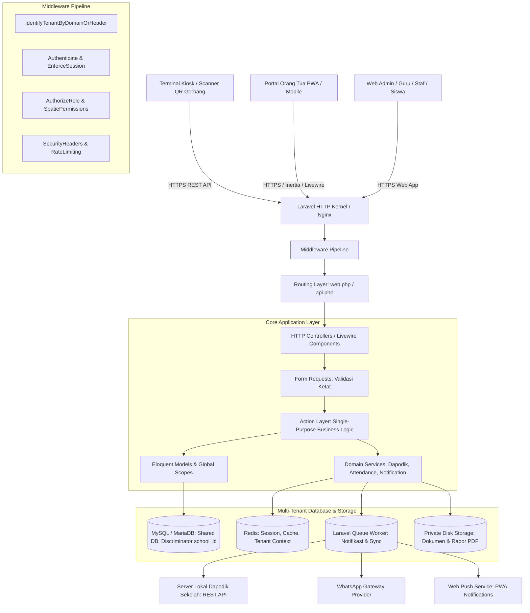
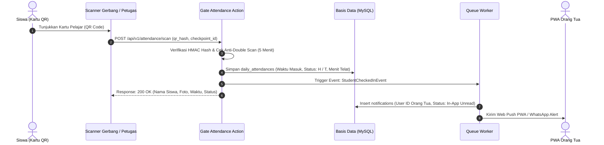
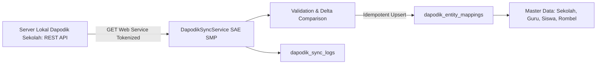

# Arsitektur Sistem (System Architecture)
## Smart Application Education Platform (SAE SMP)
### Sistem Informasi Manajemen & Akademik SMP Multi-Tenant Berbasis Laravel

- **Versi Dokumen**: 2.0.0
- **Tanggal Pembaruan**: 2026-10-20
- **Status**: Disetujui (Approved)
- **Dokumen Terkait**:
  - [PRD.md](../PRD.md)
  - [DATABASE.md](DATABASE.md)
  - [USER_ROLES.md](USER_ROLES.md)
  - [USER_FLOW.md](USER_FLOW.md)
  - [SECURITY.md](SECURITY.md)

---

## 1. Ikhtisar Arsitektur (Architectural Overview)

Smart Application Education Platform (SAE SMP) dirancang menggunakan pendekatan **Modular Monolith** dengan arsitektur berlapis (*Layered Action-Domain Architecture*) berbasis framework **Laravel 11/12 (PHP 8.2+)**. Sistem melayani banyak sekolah (*multi-tenant*) dalam satu basis kode dan basis data bersama yang diisolasi secara logis menggunakan kolom pembeda (*discriminator column*) `school_id`.



---

## 2. Strategi Multi-Tenancy (Multi-Tenant Architecture)

### 2.1 Model Tenancy: Shared Database with Discriminator Column
SAE SMP memilih model **Shared Database, Shared Schema** karena efisiensi sumber daya server, kemudahan pemeliharaan migrasi basis data, dan agregasi analitik platform:
1. **Pembeda Tenant (`school_id`)**:
   - Setiap tabel data operasional (kecuali data global platform) memiliki kolom `school_id BIGINT UNSIGNED`.
   - Integritas data antar-sekolah ditegakkan pada tingkat basis data dengan indeks gabungan (*composite unique key*) `UNIQUE(school_id, ...)`.
2. **Identifikasi Tenant Otomatis (`TenantContext`)**:
   - Tenant diidentifikasi melalui tiga metode:
     - **Subdomain**: `{subdomain}.sae-smp.id` (misal: `smpn1cipanas.sae-smp.id`).
     - **Custom Domain**: domain resmi sekolah (misal: `sim.smpn1cipanas.sch.id`).
     - **Header API**: `X-School-ID` atau Bearer Token klaim tenant untuk terminal pemindai gerbang.
3. **Penyaringan Otomatis (Laravel Global Scope)**:
   - Trait `BelongsToSchool` diterapkan pada setiap model operasional.
   - Global Scope `SchoolScope` otomatis menginjeksikan klausul `WHERE school_id = ?` pada setiap query `SELECT`, `UPDATE`, dan `DELETE`.
   - Operasi `INSERT` otomatis mengisi kolom `school_id` dari konteks sekolah aktif.

```php
// Contoh implementasi Trait BelongsToSchool
namespace App\Models\Traits;

use App\Models\Scopes\SchoolScope;
use App\Models\School;
use Illuminate\Database\Eloquent\Relations\BelongsTo;

trait BelongsToSchool
{
    protected static function bootBelongsToSchool(): void
    {
        static::addGlobalScope(new SchoolScope);

        static::creating(function ($model) {
            if (! $model->school_id && app()->bound('current_school')) {
                $model->school_id = app('current_school')->id;
            }
        });
    }

    public function school(): BelongsTo
    {
        return $this->belongsTo(School::class);
    }
}
```

---

## 3. Pola Desain Perangkat Lunak (Design Patterns & Layering)

Aplikasi menerapkan prinsip **Thin Controller, Rich Domain** dengan pemisahan tanggung jawab yang tegas:

### 3.1 Lapisan Presentasi (Presentation Layer)
- **Controllers**: Hanya bertanggung jawab menerima HTTP Request, mendelegasikan ke Form Request dan Action, serta merender Response atau View.
- **Blade & Tailwind CSS**: Antarmuka responsif ramah seluler untuk portal web sekolah.
- **Livewire & Alpine.js**: Komponen reaktif instan (pencarian real-time, checklist presensi kelas, dashboard monitoring pindaian QR gerbang).
- **PWA (Progressive Web App)**: Service Worker, Web App Manifest, dan Web Push API untuk portal wali murid.

### 3.2 Lapisan Aksi (Action Layer / Command Pattern)
- Setiap logika bisnis spesifik dikemas dalam satu kelas Action mandiri di `app/Actions/`.
- Memiliki satu metode publik `execute()` dengan *strict type declarations*.
- Transaksional: Menggunakan `DB::transaction()` untuk aksi yang melibatkan banyak tabel.
- Contoh Action:
  - `ProcessGateAttendanceAction`: Memvalidasi QR token, mencatat check-in/out, menghitung keterlambatan, dan memicu notifikasi.
  - `AdjustDailyAttendanceManualAction`: Menyimpan perubahan status manual dan menerbitkan baris log imutabel.
  - `VerifyClassJournalAction`: Verifikasi draf jurnal dari sekretaris kelas oleh guru mapel.
  - `SyncDapodikEntityAction`: Penarikan data satu arah dari Dapodik ke database lokal.

### 3.3 Lapisan Layanan Domain (Domain Service Layer)
Menangani integrasi sistem eksternal dan komputasi kompleks:
- `DapodikSyncService`: Berkomunikasi dengan Web Service resmi Dapodik lokal, mengelola handshake token, pagination data, dan mapping GUID.
- `QrSecurityService`: Hashing, enkripsi, dan verifikasi tanda tangan digital HMAC SHA-256 pada kartu pelajar.
- `NotificationDispatcherService`: Mengarahkan notifikasi ke multi-kanal (Pusat Riwayat In-App, Push Notification PWA, WhatsApp Gateway).
- `CurriculumAssessmentService`: Algoritma perhitungan nilai akhir Kurikulum Merdeka dan penyusunan kalimat deskripsi capaian kompetensi.

---

## 4. Arsitektur Subsistem Utama

### 4.1 Subsistem Presensi Dual-Layer & Log Imutabel
Sistem presensi memisahkan fisik kedatangan siswa di gerbang dan kehadiran akademis di ruang kelas:



- **Mekanisme Koreksi Manual**:
  Ketika wali kelas/piket mengubah status presensi (misal dari `Alpa` ke `Sakit` karena surat dokter):
  1. Record di `daily_attendances` diperbarui pada kolom `final_status`.
  2. Sistem wajib meng-insert baris baru pada `daily_attendance_logs` (`previous_status`, `new_status`, `change_reason`, `attachment_path`, `changed_by_user_id`).
  3. Nilai pindaian awal di `raw_method` dan `check_in_time` tetap dipertahankan.

### 4.2 Subsistem Administrasi Kelas & Akses Pengurus Kelas (Sekretaris)
1. **Hak Akses Khusus Siswa**: Siswa yang ditugaskan pada tabel `class_officers` sebagai `sekretaris_1` mendapatkan peran dinamis saat berada di sesi kelas rombelnya.
2. **Draf Jurnal KBM**: Sekretaris kelas menginput draf jurnal KBM (`class_journals` dengan `is_draft = true`) dan menandai siswa yang absen pada jam pelajaran terkait (`subject_attendances`).
3. **Gerbang Verifikasi Guru**: Guru pengampu mapel memeriksa draf tersebut. Setelah divalidasi, guru melakukan verifikasi (`class_journal_verifications`), mengubah `is_draft = false`, dan data disahkan.

### 4.3 Subsistem Integrasi Satu Arah Dapodik (One-Way Sync)

- **Prinsip Read-Only**: SAE SMP tidak pernah melakukan `POST`/`PUT`/`DELETE` ke server Dapodik lokal.
- **Idempotensi**: Setiap rekaman dicocokkan menggunakan GUID unik Dapodik (`sekolah_id`, `ptk_id`, `peserta_didik_id`, `rombongan_belajar_id`). Jika hash data tidak berubah, data di-skip untuk menghemat I/O.

### 4.4 Subsistem PWA & Pusat Notifikasi Orang Tua
1. **In-App Notification Center**: Seluruh notifikasi dicatat ke tabel `notifications` milik akun orang tua. Notifikasi tidak bergantung pada layanan pihak ketiga.
2. **Push Notification PWA**: Service Worker pada ponsel orang tua menerima payload via Web Push protocol dan menampilkan banner sistem.
3. **Kanal Sekunder WhatsApp**: Pesan teks singkat dikirim via queue job sebagai opsi notifikasi eksternal.

---

## 5. Keamanan & Kepatuhan Arsitektur

1. **Autentikasi & Autorisasi**:
   - Session-based authentication terlindungi Cookie HTTP-only, SameSite, dan Secure flag untuk aplikasi web.
   - Token-based authentication (Laravel Sanctum) untuk terminal pemindai gerbang (Kiosk).
   - Otorisasi granular menggunakan **Spatie Laravel-Permission** dengan pemisahan guard per tenant.
2. **Perlindungan Terhadap OWASP Top 10**:
   - Proteksi CSRF pada seluruh request web POST/PUT/DELETE.
   - Sanitasi XSS pada Blade output (`{{ $data }}`).
   - SQL Injection dicegah 100% menggunakan Eloquent ORM dan PDO prepared statements.
   - Rate limiting ketat pada endpoint publik dan endpoint pemindaian presensi gerbang (maks. 120 scan/menit per checkpoint).
3. **Penyimpanan Dokumen Sensitif**:
   - Berkas ijazah, akta lahir, dan rapor PDF disimpan di disk privat yang tidak dapat diakses langsung via URL web publik. Unduhan berkas dilayani melalui *Streamed Response Controller* dengan pengecekan policy hak akses.

---

## 6. Topologi Infrastruktur & Skalabilitas

```text
[Internet / Klien Sekolah]
         │
         ▼
[Cloudflare / WAF] (SSL Termination, DDoS Mitigation)
         │
         ▼
[Nginx Reverse Proxy & Load Balancer]
         │
   ┌─────┴─────────────────┐
   ▼                       ▼
[App Server 1 (Laravel)] [App Server 2 (Laravel)]
   │                       │
   ├───────────────────────┤
   │                       ▼
   │               [Redis Cluster] (Sessions, Cache, Queues)
   ▼
[MySQL / MariaDB Primary (Write)]
   │ (Replication)
   ▼
[MySQL / MariaDB Replica (Read-Heavy Queries / Analytics)]
```

- **Penyimpanan Berkas**: AWS S3-compatible object storage (MinIO atau Cloudflare R2) dengan enkripsi sisi server (SSE).
- **Background Jobs**: Supervisord mengelola worker `php artisan queue:work` untuk pengiriman notifikasi massal, kalkulasi rapor, dan sinkronisasi Dapodik.
