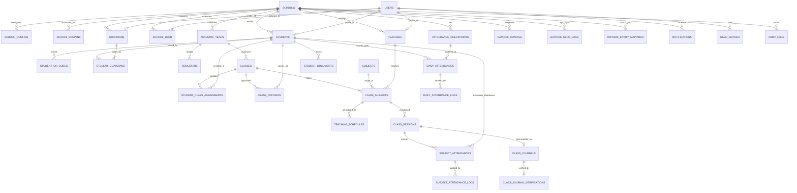

# Dokumentasi Skema Basis Data (Database Design)
## Smart Application Education Platform (SAE SMP)
### Sistem Informasi Manajemen & Akademik SMP Multi-Tenant Berbasis Laravel

- **Versi Dokumen**: 2.0.0
- **Tanggal Pembaruan**: 2026-10-20
- **Status**: Rancangan Arsitektur Basis Data Standar Produksi
- **Target Basis Data**: MySQL 8.0+ / MariaDB 10.6+ (InnoDB Engine, `utf8mb4_unicode_ci`)
- **Dokumen Terkait**:
  - [PRD.md](../PRD.md)
  - [USER_ROLES.md](USER_ROLES.md)
  - [USER_FLOW.md](USER_FLOW.md)
  - [ARCHITECTURE.md](ARCHITECTURE.md)
  - [SECURITY.md](SECURITY.md)

---

## 1. Prinsip Desain & Arsitektur Basis Data

Rancangan basis data SAE SMP dibangun di atas 12 prinsip arsitektural utama:

1. **Multi-Tenancy Terisolasi (Shared Database, Discriminator Column)**:
   - Setiap tabel operasional sekolah wajib menyertakan kolom `school_id` (`BIGINT UNSIGNED`).
   - Setiap query data aplikasi secara otomatis disaring melalui Laravel Global Scope (`SchoolScope`).
   - Penegakan integritas data unik menggunakan indeks komposit kombinasi `school_id` dan atribut unik (misal: `UNIQUE(school_id, nisn)`, `UNIQUE(school_id, class_name)`), mencegah bentrokan data antar-sekolah.
2. **Keamanan & Kriptografi**:
   - Kata sandi di-hash menggunakan algoritma Bcrypt / Argon2id.
   - Token pada kartu pelajar berbasis QR Code dienkripsi menggunakan salt acak dan diverifikasi melalui HMAC SHA-256 (`qr_token_hash`), sehingga kode QR tidak dapat dibuat secara ilegal atau dipalsukan oleh siswa.
   - Catatan konseling Bimbingan Konseling (BK) dienkripsi di tingkat kolom (Laravel Model Encryption).
3. **Integritas Relasional Ketat (Foreign Key Strategy)**:
   - Hubungan induk-anak transaksional menggunakan `ON DELETE CASCADE` bila penghapusan induk membatalkan anak (misal: `assessments` -> `student_grades`).
   - Data historis dan master data kritis menggunakan `ON DELETE RESTRICT` untuk mencegah data terhapus secara tidak sengaja (misal: `classes` tidak dapat dihapus jika masih ada siswa terdaftar).
4. **Immutabilitas Transaksi Presensi (Append-Only Audit Logs)**:
   - Koreksi presensi manual oleh wali kelas atau guru piket **DILARANG** menimpa riwayat pemindaian mesin mentah.
   - Setiap perubahan status menghasilkan rekaman baru di tabel log riwayat (`daily_attendance_logs` dan `subject_attendance_logs`) yang mencatat status lama, status baru, alasan pengubahan, bukti pendukung, dan identitas petugas.
5. **Pemisahan Presensi Harian (Gate) dan Presensi KBM (Per Mata Pelajaran)**:
   - Presensi kedatangan/kepulangan di gerbang (`daily_attendances`) berjalan mandiri untuk memantau keberadaan fisik siswa di sekolah.
   - Presensi per mata pelajaran (`subject_attendances`) berjalan per jam KBM (`class_sessions`), memungkinkan deteksi dini anomali siswa yang hadir di gerbang namun membolos di kelas tertentu.
6. **Desentralisasi & Delegasi Administrasi Kelas**:
   - Pengurus kelas (Sekretaris / Ketua Kelas) memiliki akun siswa dengan hak istimewa terkontrol untuk menginput draf jurnal kelas dan draf ketidakhadiran jam pelajaran.
   - Draf dari pengurus kelas memiliki status `draft` dan wajib melalui alur verifikasi resmi oleh Guru Mata Pelajaran atau Wali Kelas sebelum sah menjadi data absensi/jurnal.
7. **Keluarga & Akses PWA Orang Tua**:
   - Akun orang tua terhubung ke satu atau lebih siswa melalui tabel relasi `student_guardians`.
   - Riwayat notifikasi tersimpan secara persisten pada basis data internal (`notifications`), sehingga orang tua dapat meninjau seluruh riwayat aktivitas anak kapan saja melalui PWA meskipun pesan WhatsApp terhapus.
8. **Sinkronisasi Dapodik Satu Arah (Idempotent Mapping)**:
   - Integrasi resmi dari server Dapodik lokal menggunakan mapping GUID (`dapodik_guid`) untuk setiap entitas sinkronisasi (sekolah, PTK, PD, rombel, pembelajaran).
   - Sinkronisasi bersifat *read-only one-way* dari Dapodik ke SAE SMP, mencegah terjadinya modifikasi data yang merusak basis data Dapodik sekolah.
9. **Normalisasi & Kinerja Indeks**:
   - Skema dirancang memenuhi kaidah Third Normal Form (3NF).
   - Indeks komposit diterapkan secara strategis pada kolom yang sering dicari: pencarian presensi per tanggal dan rombel, pencarian tagihan per siswa dan status, serta filter audit log.
10. **Fleksibilitas Atribut Dinamis**:
    - Konfigurasi sekolah, parameter penilaian Kurikulum Merdeka, serta payload webhook disimpan dalam format kolom `JSON` yang terstruktur, memungkinkan ekstensi konfigurasi tanpa mengubah skema tabel (*schema-less attributes*).
11. **Pencatatan Jejak Audit Menyeluruh (Audit Trail)**:
    - Seluruh operasi Create, Update, Delete, dan Login tercatat pada tabel `audit_logs` dengan snapshot nilai sebelum dan sesudah perubahan.
12. **Arsip Dokumen Digital Terintegrasi**:
    - Dokumen fisik siswa (Akta Kelahiran, Kartu Keluarga, Ijazah) dan berkas digital Rapor Semester tersimpan dengan hash integritas (SHA-256) untuk verifikasi keaslian.

---

## 2. Diagram Relasi Entitas Utama (Mermaid ERD)

---

## 3. Rincian Modul & Spesifikasi Tabel Basis Data

### 3.1 Kelompok 1: Multi-Tenant & Identitas Sekolah (Multi-Tenant & School Identity)

Modul ini mengelola data instansi sekolah, domain kustom/subdomain, konfigurasi operasional presensi, dan titik checkpoint gerbang.

#### 1. Tabel: `schools`
Menyimpan data identitas resmi setiap satuan pendidikan SMP yang terdaftar.
| Kolom | Tipe Data | Keterangan |
| :--- | :--- | :--- |
| `id` | `BIGINT UNSIGNED AUTO_INCREMENT` | Primary Key |
| `npsn` | `VARCHAR(10)` | Nomor Pokok Sekolah Nasional (Unique global) |
| `name` | `VARCHAR(150)` | Nama resmi sekolah (misal: SMP Negeri 1 Contoh) |
| `school_type` | `ENUM('negeri', 'swasta')` | Jenis status sekolah |
| `education_level` | `VARCHAR(10)` | Default `SMP` |
| `status_license` | `ENUM('trial', 'active', 'suspended', 'expired')` | Status lisensi platform SAE SMP |
| `license_valid_until`| `DATE` | Masa berlaku lisensi sistem |
| `email` | `VARCHAR(100)` | Email resmi sekolah |
| `phone_number` | `VARCHAR(30)` | Nomor telepon resmi sekolah |
| `address` | `TEXT` | Alamat lengkap sekolah |
| `village` | `VARCHAR(80)` | Kelurahan / Desa |
| `district` | `VARCHAR(80)` | Kecamatan |
| `city` | `VARCHAR(80)` | Kota / Kabupaten |
| `province` | `VARCHAR(80)` | Provinsi |
| `postal_code` | `VARCHAR(10)` | Kode pos |
| `logo_path` | `VARCHAR(255)` | Nullable, path logo sekolah |
| `letterhead_path` | `VARCHAR(255)` | Nullable, template kop surat resmi |
| `created_at` / `updated_at` | `TIMESTAMP` | Timestamps |
| `deleted_at` | `TIMESTAMP` | Soft Deletes |

*Indeks:*
- `UNIQUE KEY uk_schools_npsn (npsn)`

#### 2. Tabel: `school_configs`
Menyimpan konfigurasi operasional, waktu toleransi presensi, dan kebijakan spesifik per sekolah.
| Kolom | Tipe Data | Keterangan |
| :--- | :--- | :--- |
| `id` | `BIGINT UNSIGNED AUTO_INCREMENT` | Primary Key |
| `school_id` | `BIGINT UNSIGNED` | Foreign Key ke `schools.id` (Unique, Cascade) |
| `timezone` | `VARCHAR(40)` | Default `Asia/Jakarta` (WIB/WITA/WIT) |
| `gate_in_start_time` | `TIME` | Waktu gerbang dibuka untuk scan masuk (misal: 06:00:00) |
| `gate_in_deadline` | `TIME` | Batas akhir kedatangan tepat waktu (misal: 07:00:00) |
| `gate_in_late_limit` | `TIME` | Batas kedatangan terlambat maksimal (misal: 07:30:00) |
| `gate_out_start_time` | `TIME` | Waktu awal scan pulang diperbolehkan (misal: 14:00:00) |
| `gate_out_start_friday`| `TIME` | Waktu awal scan pulang khusus hari Jumat (misal: 11:30:00) |
| `auto_alpha_trigger_time`| `TIME` | Jam otomatis sistem menandai Alpa siswa tak hadir (08:00:00) |
| `prevent_double_scan_minutes`| `SMALLINT UNSIGNED` | Durasi anti scan ganda (default: 5 menit) |
| `sp1_threshold_point`| `SMALLINT UNSIGNED` | Batas poin SP 1 (default: 50 poin) |
| `sp2_threshold_point`| `SMALLINT UNSIGNED` | Batas poin SP 2 (default: 75 poin) |
| `sp3_threshold_point`| `SMALLINT UNSIGNED` | Batas poin SP 3 (default: 100 poin) |
| `extra_settings` | `JSON` | Pengaturan dinamis tambahan (WhatsApp gateway provider, dsb) |
| `created_at` / `updated_at` | `TIMESTAMP` | Timestamps |

#### 3. Tabel: `school_domains`
Memetakan subdomain atau custom domain sekolah untuk routing multi-tenant.
| Kolom | Tipe Data | Keterangan |
| :--- | :--- | :--- |
| `id` | `BIGINT UNSIGNED AUTO_INCREMENT` | Primary Key |
| `school_id` | `BIGINT UNSIGNED` | Foreign Key ke `schools.id` (Cascade) |
| `domain` | `VARCHAR(150)` | Subdomain (`smpn1.sae-smp.id`) atau custom (`sim.smpn1.sch.id`) |
| `is_primary` | `BOOLEAN` | Domain rujukan utama |
| `is_verified` | `BOOLEAN` | Status verifikasi DNS domain kustom |
| `created_at` / `updated_at` | `TIMESTAMP` | Timestamps |

*Indeks:*
- `UNIQUE KEY uk_school_domains_domain (domain)`
- `INDEX idx_school_domains_school_id (school_id)`

#### 4. Tabel: `attendance_checkpoints`
Daftar lokasi pemindaian presensi di lingkungan sekolah.
| Kolom | Tipe Data | Keterangan |
| :--- | :--- | :--- |
| `id` | `BIGINT UNSIGNED AUTO_INCREMENT` | Primary Key |
| `school_id` | `BIGINT UNSIGNED` | Foreign Key ke `schools.id` (Cascade) |
| `code` | `VARCHAR(30)` | Kode pos pemindaian (misal: `GATE-01`, `GATE-02`, `PIKET`) |
| `name` | `VARCHAR(100)` | Nama lokasi (misal: Gerbang Utama, Pos Satpam Utara) |
| `device_identifier` | `VARCHAR(100)` | Nullable, MAC Address/UUID tablet scanner |
| `is_active` | `BOOLEAN` | Status aktif/non-aktif pos |
| `created_at` / `updated_at` | `TIMESTAMP` | Timestamps |

*Indeks:*
- `UNIQUE KEY uk_checkpoints_school_code (school_id, code)`

---

### 3.2 Kelompok 2: Pengguna, Keamanan & Hak Akses (Users & RBAC)

Modul autentikasi yang mendukung multi-keanggotaan sekolah, penanganan peran Spatie terisolasi, serta manajemen token push notification perangkat PWA.

#### 5. Tabel: `users`
Tabel pengguna sentral. Dapat memiliki peran berbeda di sekolah yang berbeda.
| Kolom | Tipe Data | Keterangan |
| :--- | :--- | :--- |
| `id` | `BIGINT UNSIGNED AUTO_INCREMENT` | Primary Key |
| `name` | `VARCHAR(150)` | Nama pengguna tampilan |
| `username` | `VARCHAR(60)` | Unik global (NISN / NIP / Kode Pegawai / Email) |
| `email` | `VARCHAR(100)` | Nullable, unik global |
| `phone_number` | `VARCHAR(25)` | Nullable, nomor WhatsApp untuk autentikasi & alert |
| `password` | `VARCHAR(255)` | Hash kata sandi |
| `remember_token` | `VARCHAR(100)` | Laravel remember token |
| `is_active` | `BOOLEAN` | Status aktif akun (default: `true`) |
| `last_login_at` | `TIMESTAMP` | Nullable, jejak waktu login terakhir |
| `last_login_ip` | `VARCHAR(45)` | Nullable, alamat IP login terakhir |
| `created_at` / `updated_at` | `TIMESTAMP` | Timestamps |
| `deleted_at` | `TIMESTAMP` | Soft Deletes |

*Indeks:*
- `UNIQUE KEY uk_users_username (username)`
- `UNIQUE KEY uk_users_email (email)`

#### 6. Tabel: `school_user`
Menghubungkan pengguna dengan satu atau lebih sekolah (*tenant affiliation*).
| Kolom | Tipe Data | Keterangan |
| :--- | :--- | :--- |
| `id` | `BIGINT UNSIGNED AUTO_INCREMENT` | Primary Key |
| `school_id` | `BIGINT UNSIGNED` | Foreign Key ke `schools.id` (Cascade) |
| `user_id` | `BIGINT UNSIGNED` | Foreign Key ke `users.id` (Cascade) |
| `primary_role` | `VARCHAR(40)` | Peran utama pada sekolah ini (misal: `guru_mapel`, `siswa`, `orang_tua`) |
| `is_active` | `BOOLEAN` | Status akses aktif di sekolah ini |
| `created_at` / `updated_at` | `TIMESTAMP` | Timestamps |

*Indeks:*
- `UNIQUE KEY uk_school_user (school_id, user_id)`
- `INDEX idx_school_user_role (school_id, primary_role)`

#### 7. Tabel: `user_devices`
Menyimpan token push notification browser PWA untuk orang tua, guru, dan staf.
| Kolom | Tipe Data | Keterangan |
| :--- | :--- | :--- |
| `id` | `BIGINT UNSIGNED AUTO_INCREMENT` | Primary Key |
| `user_id` | `BIGINT UNSIGNED` | Foreign Key ke `users.id` (Cascade) |
| `device_type` | `ENUM('android', 'ios', 'desktop_browser')` | Jenis platform peramban |
| `endpoint` | `TEXT` | Web Push Subscription Endpoint |
| `public_key` | `TEXT` | Public key enkripsi push |
| `auth_token` | `TEXT` | Auth token Web Push |
| `last_active_at` | `TIMESTAMP` | Waktu aktif terakhir perangkat |
| `created_at` / `updated_at` | `TIMESTAMP` | Timestamps |

---

### 3.3 Kelompok 3: Data Akademik & Kurikulum (Academic & Curriculum)

Mengelola kalender akademik, rombel kelas, kurikulum, pemetaan mata pelajaran, sesi KBM, asesmen Kurikulum Merdeka, dan rapor digital.

#### 8. Tabel: `academic_years`
Tahun ajaran akademik per sekolah.
| Kolom | Tipe Data | Keterangan |
| :--- | :--- | :--- |
| `id` | `BIGINT UNSIGNED AUTO_INCREMENT` | Primary Key |
| `school_id` | `BIGINT UNSIGNED` | Foreign Key ke `schools.id` (Cascade) |
| `year_name` | `VARCHAR(20)` | Contoh: `2026/2027` |
| `is_active` | `BOOLEAN` | Hanya boleh ada 1 tahun ajaran aktif per sekolah |
| `start_date` | `DATE` | Tanggal mulai tahun ajaran |
| `end_date` | `DATE` | Tanggal berakhir tahun ajaran |
| `created_at` / `updated_at` | `TIMESTAMP` | Timestamps |

*Indeks:*
- `UNIQUE KEY uk_academic_years (school_id, year_name)`

#### 9. Tabel: `semesters`
Semester akademik di dalam tahun ajaran.
| Kolom | Tipe Data | Keterangan |
| :--- | :--- | :--- |
| `id` | `BIGINT UNSIGNED AUTO_INCREMENT` | Primary Key |
| `school_id` | `BIGINT UNSIGNED` | Foreign Key ke `schools.id` (Cascade) |
| `academic_year_id` | `BIGINT UNSIGNED` | Foreign Key ke `academic_years.id` (Cascade) |
| `semester_type` | `ENUM('odd', 'even')` | Ganjil / Genap |
| `is_active` | `BOOLEAN` | Semester yang sedang berjalan |
| `report_date` | `DATE` | Tanggal titimangsa cetak buku rapor |
| `created_at` / `updated_at` | `TIMESTAMP` | Timestamps |

*Indeks:*
- `UNIQUE KEY uk_semesters (academic_year_id, semester_type)`

#### 10. Tabel: `classes` (Rombongan Belajar)
Daftar kelas rombel pada tahun ajaran berjalan.
| Kolom | Tipe Data | Keterangan |
| :--- | :--- | :--- |
| `id` | `BIGINT UNSIGNED AUTO_INCREMENT` | Primary Key |
| `school_id` | `BIGINT UNSIGNED` | Foreign Key ke `schools.id` (Cascade) |
| `academic_year_id` | `BIGINT UNSIGNED` | Foreign Key ke `academic_years.id` (Restrict) |
| `level` | `TINYINT UNSIGNED` | Tingkat kelas: `7`, `8`, atau `9` |
| `class_name` | `VARCHAR(40)` | Nama rombel (misal: `7A`, `8 Bilingual`, `9 Unggulan`) |
| `homeroom_teacher_id` | `BIGINT UNSIGNED` | Nullable, Foreign Key ke `teachers.id` (Restrict) |
| `max_capacity` | `TINYINT UNSIGNED` | Batas kapasitas siswa (default: 32) |
| `room_name` | `VARCHAR(50)` | Nullable, nama ruang fisik kelas |
| `dapodik_rombel_id` | `VARCHAR(50)` | Nullable, GUID referensi rombel Dapodik |
| `created_at` / `updated_at` | `TIMESTAMP` | Timestamps |
| `deleted_at` | `TIMESTAMP` | Soft Deletes |

*Indeks:*
- `UNIQUE KEY uk_classes_name (school_id, academic_year_id, class_name)`

#### 11. Tabel: `subjects`
Master mata pelajaran sekolah.
| Kolom | Tipe Data | Keterangan |
| :--- | :--- | :--- |
| `id` | `BIGINT UNSIGNED AUTO_INCREMENT` | Primary Key |
| `school_id` | `BIGINT UNSIGNED` | Foreign Key ke `schools.id` (Cascade) |
| `code` | `VARCHAR(25)` | Kode unik sekolah (misal: `PAI`, `MTK`, `IPA`, `PJOK`) |
| `name` | `VARCHAR(120)` | Nama mata pelajaran |
| `group_category` | `ENUM('umum_a', 'umum_b', 'muatan_lokal', 'ekstrakurikuler')` | Kelompok kurikulum |
| `order_number` | `SMALLINT UNSIGNED` | Nomor urut tampilan di buku rapor |
| `dapodik_mapel_id` | `VARCHAR(50)` | Nullable, ID referensi Dapodik |
| `created_at` / `updated_at` | `TIMESTAMP` | Timestamps |

*Indeks:*
- `UNIQUE KEY uk_subjects_code (school_id, code)`

#### 12. Tabel: `class_subjects`
Pengalokasian mata pelajaran, guru pengampu, dan rombel kelas pada semester berjalan.
| Kolom | Tipe Data | Keterangan |
| :--- | :--- | :--- |
| `id` | `BIGINT UNSIGNED AUTO_INCREMENT` | Primary Key |
| `school_id` | `BIGINT UNSIGNED` | Foreign Key ke `schools.id` (Cascade) |
| `class_id` | `BIGINT UNSIGNED` | Foreign Key ke `classes.id` (Cascade) |
| `subject_id` | `BIGINT UNSIGNED` | Foreign Key ke `subjects.id` (Restrict) |
| `teacher_id` | `BIGINT UNSIGNED` | Foreign Key ke `teachers.id` (Guru Pengampu) |
| `semester_id` | `BIGINT UNSIGNED` | Foreign Key ke `semesters.id` (Cascade) |
| `kkm` | `DECIMAL(4,1)` | Kriteria Ketercapaian Tujuan Pembelajaran (KKTP) |
| `weekly_hours` | `TINYINT UNSIGNED` | Beban Jam Pelajaran per minggu (misal: 4 JP) |
| `dapodik_pembelajaran_id`| `VARCHAR(50)` | Nullable, GUID pembelajaran Dapodik |
| `created_at` / `updated_at` | `TIMESTAMP` | Timestamps |

*Indeks:*
- `UNIQUE KEY uk_class_subjects (class_id, subject_id, semester_id)`
- `INDEX idx_class_subjects_teacher (school_id, teacher_id)`

#### 13. Tabel: `teaching_schedules`
Jadwal pelajaran mingguan per jam dan ruangan.
| Kolom | Tipe Data | Keterangan |
| :--- | :--- | :--- |
| `id` | `BIGINT UNSIGNED AUTO_INCREMENT` | Primary Key |
| `school_id` | `BIGINT UNSIGNED` | Foreign Key ke `schools.id` (Cascade) |
| `class_subject_id` | `BIGINT UNSIGNED` | Foreign Key ke `class_subjects.id` (Cascade) |
| `day_of_week` | `ENUM('monday', 'tuesday', 'wednesday', 'thursday', 'friday', 'saturday')` | Hari KBM |
| `period_order` | `TINYINT UNSIGNED` | Jam ke- (misal: Jam 1, Jam 2) |
| `start_time` | `TIME` | Waktu mulai |
| `end_time` | `TIME` | Waktu selesai |
| `room_name` | `VARCHAR(50)` | Ruang kelas atau laboratorium |
| `created_at` / `updated_at` | `TIMESTAMP` | Timestamps |

*Indeks:*
- `INDEX idx_schedules_lookup (school_id, day_of_week, start_time)`

#### 14. Tabel: `learning_objectives` (Tujuan Pembelajaran - TP)
Daftar Tujuan Pembelajaran Kurikulum Merdeka per semester.
| Kolom | Tipe Data | Keterangan |
| :--- | :--- | :--- |
| `id` | `BIGINT UNSIGNED AUTO_INCREMENT` | Primary Key |
| `school_id` | `BIGINT UNSIGNED` | Foreign Key ke `schools.id` (Cascade) |
| `class_subject_id` | `BIGINT UNSIGNED` | Foreign Key ke `class_subjects.id` (Cascade) |
| `code` | `VARCHAR(20)` | Kode TP (misal: `TP-01`, `TP-02`) |
| `topic_name` | `VARCHAR(150)` | Lingkup Materi pokok bahasan |
| `description` | `TEXT` | Uraian capaian kompetensi |
| `created_at` / `updated_at` | `TIMESTAMP` | Timestamps |

#### 15. Tabel: `assessments`
Agenda asesmen formatif dan sumatif yang diadakan guru.
| Kolom | Tipe Data | Keterangan |
| :--- | :--- | :--- |
| `id` | `BIGINT UNSIGNED AUTO_INCREMENT` | Primary Key |
| `school_id` | `BIGINT UNSIGNED` | Foreign Key ke `schools.id` (Cascade) |
| `class_subject_id` | `BIGINT UNSIGNED` | Foreign Key ke `class_subjects.id` (Cascade) |
| `learning_objective_id` | `BIGINT UNSIGNED` | Nullable, Foreign Key ke `learning_objectives.id` |
| `title` | `VARCHAR(120)` | Judul asesmen (misal: Sumatif Lingkup Materi 1 Aljabar) |
| `assessment_type` | `ENUM('formatif', 'sumatif_materi', 'sumatif_akhir')` | Jenis asesmen |
| `weight` | `DECIMAL(4,2)` | Bobot persentase perhitungan nilai (default: 1.0) |
| `assessment_date` | `DATE` | Tanggal pelaksanaan ujian/tugas |
| `created_at` / `updated_at` | `TIMESTAMP` | Timestamps |

#### 16. Tabel: `student_grades`
Nilai capaian per siswa per asesmen.
| Kolom | Tipe Data | Keterangan |
| :--- | :--- | :--- |
| `id` | `BIGINT UNSIGNED AUTO_INCREMENT` | Primary Key |
| `school_id` | `BIGINT UNSIGNED` | Foreign Key ke `schools.id` (Cascade) |
| `assessment_id` | `BIGINT UNSIGNED` | Foreign Key ke `assessments.id` (Cascade) |
| `student_id` | `BIGINT UNSIGNED` | Foreign Key ke `students.id` (Cascade) |
| `score` | `DECIMAL(5,2)` | Nilai angka (rentang 0.00 s.d 100.00) |
| `teacher_notes` | `TEXT` | Nullable, umpan balik kualitatif guru |
| `created_at` / `updated_at` | `TIMESTAMP` | Timestamps |

*Indeks:*
- `UNIQUE KEY uk_student_grades (assessment_id, student_id)`
- `INDEX idx_student_grades_student (school_id, student_id)`

#### 17. Tabel: `p5_themes`, `p5_projects`, & `p5_assessments`
Menyimpan komponen penilaian Projek Penguatan Profil Pelajar Pancasila (P5) Fase D:
- `p5_themes`: Tema utama P5 (Gaya Hidup Berkelanjutan, Kearifan Lokal, Suara Demokrasi, dsb).
- `p5_projects`: Judul projek pada kelas bersangkutan.
- `p5_assessments`: Penilaian dimensi dan sub-elemen siswa dengan predikat (`BB`, `MB`, `BSH`, `SB`).

#### 18. Tabel: `report_cards`
Buku Rapor Digital per siswa per semester sebelum pengesahan dan pencetakan resmi.
| Kolom | Tipe Data | Keterangan |
| :--- | :--- | :--- |
| `id` | `BIGINT UNSIGNED AUTO_INCREMENT` | Primary Key |
| `school_id` | `BIGINT UNSIGNED` | Foreign Key ke `schools.id` (Cascade) |
| `student_id` | `BIGINT UNSIGNED` | Foreign Key ke `students.id` (Restrict) |
| `semester_id` | `BIGINT UNSIGNED` | Foreign Key ke `semesters.id` (Restrict) |
| `class_id` | `BIGINT UNSIGNED` | Foreign Key ke `classes.id` (Restrict) |
| `attendance_summary` | `JSON` | Rekap kehadiran semester: `{ "H": 82, "S": 2, "I": 1, "A": 0, "T": 1 }` |
| `extracurricular_grades`| `JSON` | Nilai ekstra: `[{"name": "Pramuka", "grade": "A", "notes": "Sangat aktif"}]` |
| `homeroom_notes` | `TEXT` | Catatan perkembangan kepribadian dari Wali Kelas |
| `decision` | `ENUM('promoted', 'retained', 'graduated')` | Keputusan kenaikan kelas / kelulusan |
| `is_approved_by_principal`| `BOOLEAN` | Persetujuan Kepala Sekolah (default: `false`) |
| `approved_at` | `TIMESTAMP` | Nullable, tanggal waktu pengesahan |
| `created_at` / `updated_at` | `TIMESTAMP` | Timestamps |

*Indeks:*
- `UNIQUE KEY uk_report_cards (student_id, semester_id)`

---

### 3.4 Kelompok 4: Data Kependidikan & Keluarga (Staff, Students & Family)

Mengelola data profil Guru & Tenaga Kependidikan (GTK), Siswa, Orang Tua/Wali Murid, serta Kartu Pelajar berbasis QR Code.

#### 19. Tabel: `teachers`
Data rinci Guru dan Tenaga Kependidikan.
| Kolom | Tipe Data | Keterangan |
| :--- | :--- | :--- |
| `id` | `BIGINT UNSIGNED AUTO_INCREMENT` | Primary Key |
| `school_id` | `BIGINT UNSIGNED` | Foreign Key ke `schools.id` (Cascade) |
| `user_id` | `BIGINT UNSIGNED` | Foreign Key ke `users.id` (Cascade) |
| `nip` | `VARCHAR(30)` | Nullable, Nomor Induk Pegawai |
| `nuptk` | `VARCHAR(30)` | Nullable, NUPTK resmi Kemendikbud |
| `full_name` | `VARCHAR(150)` | Nama lengkap beserta gelar akademik |
| `gender` | `ENUM('L', 'P')` | Laki-laki / Perempuan |
| `birth_place` | `VARCHAR(60)` | Tempat lahir |
| `birth_date` | `DATE` | Tanggal lahir |
| `phone_number` | `VARCHAR(25)` | Nomor telepon aktif |
| `address` | `TEXT` | Alamat tempat tinggal |
| `employment_status`| `ENUM('PNS', 'P3K', 'GTT', 'GTY', 'Honorer')` | Status kepegawaian |
| `signature_path` | `VARCHAR(255)` | Nullable, file tanda tangan digital untuk rapor |
| `dapodik_ptk_id` | `VARCHAR(50)` | Nullable, GUID referensi PTK Dapodik |
| `created_at` / `updated_at` | `TIMESTAMP` | Timestamps |
| `deleted_at` | `TIMESTAMP` | Soft Deletes |

*Indeks:*
- `UNIQUE KEY uk_teachers_school_user (school_id, user_id)`
- `INDEX idx_teachers_nip (school_id, nip)`

#### 20. Tabel: `students`
Data lengkap siswa peserta didik aktif dan riwayat alumni.
| Kolom | Tipe Data | Keterangan |
| :--- | :--- | :--- |
| `id` | `BIGINT UNSIGNED AUTO_INCREMENT` | Primary Key |
| `school_id` | `BIGINT UNSIGNED` | Foreign Key ke `schools.id` (Cascade) |
| `user_id` | `BIGINT UNSIGNED` | Nullable, Foreign Key ke `users.id` (Cascade) |
| `nis` | `VARCHAR(25)` | Nomor Induk Siswa internal sekolah |
| `nisn` | `VARCHAR(20)` | Nomor Induk Siswa Nasional (Wajib unik per sekolah) |
| `nik` | `VARCHAR(25)` | Nomor Induk Kependudukan siswa |
| `full_name` | `VARCHAR(150)` | Nama lengkap siswa sesuai akta kelahiran |
| `gender` | `ENUM('L', 'P')` | Laki-laki / Perempuan |
| `birth_place` | `VARCHAR(60)` | Tempat lahir |
| `birth_date` | `DATE` | Tanggal lahir |
| `religion` | `VARCHAR(30)` | Agama siswa |
| `address` | `TEXT` | Alamat domisili siswa |
| `entry_year` | `YEAR` | Tahun pertama kali terdaftar |
| `status` | `ENUM('active', 'graduated', 'transferred', 'dropped_out')` | Status aktif siswa |
| `photo_path` | `VARCHAR(255)` | Nullable, foto profil resmi siswa |
| `dapodik_pd_id` | `VARCHAR(50)` | Nullable, GUID referensi Peserta Didik Dapodik |
| `created_at` / `updated_at` | `TIMESTAMP` | Timestamps |
| `deleted_at` | `TIMESTAMP` | Soft Deletes |

*Indeks:*
- `UNIQUE KEY uk_students_nisn (school_id, nisn)`
- `INDEX idx_students_nis (school_id, nis)`
- `INDEX idx_students_status (school_id, status)`

#### 21. Tabel: `student_qr_codes`
Mengelola token QR Code kartu pelajar siswa dengan enkripsi dan validasi masa berlaku.
| Kolom | Tipe Data | Keterangan |
| :--- | :--- | :--- |
| `id` | `BIGINT UNSIGNED AUTO_INCREMENT` | Primary Key |
| `school_id` | `BIGINT UNSIGNED` | Foreign Key ke `schools.id` (Cascade) |
| `student_id` | `BIGINT UNSIGNED` | Foreign Key ke `students.id` (Cascade) |
| `qr_token_hash` | `VARCHAR(64)` | Hash SHA-256 token kartu untuk pencarian cepat |
| `encrypted_payload`| `TEXT` | Payload terenkripsi memuat: `student_id`, `school_id`, `issued_at`, `salt` |
| `version` | `SMALLINT UNSIGNED` | Versi cetak kartu (jika kartu hilang dan dicetak ulang) |
| `is_active` | `BOOLEAN` | Status aktif kartu (kartu lama otomatis non-aktif jika cetak baru) |
| `issued_at` | `TIMESTAMP` | Tanggal terbit kartu |
| `expires_at` | `TIMESTAMP` | Nullable, masa berlaku kartu |
| `created_at` / `updated_at` | `TIMESTAMP` | Timestamps |

*Indeks:*
- `UNIQUE KEY uk_student_qr_hash (qr_token_hash)`
- `INDEX idx_student_qr_active (school_id, student_id, is_active)`

#### 22. Tabel: `guardians` (Orang Tua / Wali Murid)
Data profil orang tua atau wali resmi siswa.
| Kolom | Tipe Data | Keterangan |
| :--- | :--- | :--- |
| `id` | `BIGINT UNSIGNED AUTO_INCREMENT` | Primary Key |
| `school_id` | `BIGINT UNSIGNED` | Foreign Key ke `schools.id` (Cascade) |
| `user_id` | `BIGINT UNSIGNED` | Foreign Key ke `users.id` (Cascade) |
| `full_name` | `VARCHAR(150)` | Nama lengkap orang tua / wali |
| `nik` | `VARCHAR(25)` | NIK orang tua |
| `phone_number` | `VARCHAR(25)` | Nomor telepon / WhatsApp aktif untuk notifikasi |
| `occupation` | `VARCHAR(80)` | Pekerjaan |
| `monthly_income` | `DECIMAL(12,2)` | Nullable, penghasilan bulanan |
| `address` | `TEXT` | Alamat domisili |
| `created_at` / `updated_at` | `TIMESTAMP` | Timestamps |

*Indeks:*
- `UNIQUE KEY uk_guardians_school_user (school_id, user_id)`
- `INDEX idx_guardians_phone (school_id, phone_number)`

#### 23. Tabel: `student_guardians`
Relasi banyak-ke-banyak antara siswa dan orang tua/wali murid.
| Kolom | Tipe Data | Keterangan |
| :--- | :--- | :--- |
| `id` | `BIGINT UNSIGNED AUTO_INCREMENT` | Primary Key |
| `school_id` | `BIGINT UNSIGNED` | Foreign Key ke `schools.id` (Cascade) |
| `student_id` | `BIGINT UNSIGNED` | Foreign Key ke `students.id` (Cascade) |
| `guardian_id` | `BIGINT UNSIGNED` | Foreign Key ke `guardians.id` (Cascade) |
| `relationship_type`| `ENUM('father', 'mother', 'guardian')` | Hubungan keluarga |
| `is_primary_contact`| `BOOLEAN` | Penanda nomor kontak darurat utama |
| `is_tuition_responsible`| `BOOLEAN` | Penanggung jawab tagihan SPP sekolah |
| `created_at` / `updated_at` | `TIMESTAMP` | Timestamps |

*Indeks:*
- `UNIQUE KEY uk_student_guardians (student_id, guardian_id)`
- `INDEX idx_student_guardians_guardian (guardian_id)`

#### 24. Tabel: `student_class_assignments`
Penempatan siswa di rombel kelas per tahun ajaran.
| Kolom | Tipe Data | Keterangan |
| :--- | :--- | :--- |
| `id` | `BIGINT UNSIGNED AUTO_INCREMENT` | Primary Key |
| `school_id` | `BIGINT UNSIGNED` | Foreign Key ke `schools.id` (Cascade) |
| `class_id` | `BIGINT UNSIGNED` | Foreign Key ke `classes.id` (Cascade) |
| `student_id` | `BIGINT UNSIGNED` | Foreign Key ke `students.id` (Cascade) |
| `academic_year_id` | `BIGINT UNSIGNED` | Foreign Key ke `academic_years.id` (Restrict) |
| `roll_number` | `TINYINT UNSIGNED` | Nomor urut presensi di kelas |
| `created_at` / `updated_at` | `TIMESTAMP` | Timestamps |

*Indeks:*
- `UNIQUE KEY uk_student_class_enrollment (academic_year_id, student_id)`
- `INDEX idx_class_assignments_class (class_id, roll_number)`

---

### 3.5 Kelompok 5: Integrasi Dapodik Satu Arah (One-Way Dapodik Sync)

Mengelola kredensial koneksi ke server Dapodik lokal, log riwayat penarikan data, dan pemetaan GUID Dapodik ke ID lokal SAE SMP.

#### 25. Tabel: `dapodik_configs`
Pengaturan Web Service resmi Dapodik lokal sekolah.
| Kolom | Tipe Data | Keterangan |
| :--- | :--- | :--- |
| `id` | `BIGINT UNSIGNED AUTO_INCREMENT` | Primary Key |
| `school_id` | `BIGINT UNSIGNED` | Foreign Key ke `schools.id` (Unique, Cascade) |
| `server_ip_url` | `VARCHAR(200)` | URL Web Service Dapodik (misal: `http://192.168.1.100:5774`) |
| `web_service_token`| `VARCHAR(255)` | Token resmi yang digenerate di aplikasi Dapodik lokal |
| `npsn` | `VARCHAR(10)` | NPSN sekolah validasi |
| `sync_mode` | `ENUM('web_service', 'file_import')` | Mode penarikan data |
| `is_active` | `BOOLEAN` | Status aktif koneksi integrasi |
| `last_tested_at` | `TIMESTAMP` | Nullable, waktu pengujian koneksi terakhir |
| `created_at` / `updated_at` | `TIMESTAMP` | Timestamps |

#### 26. Tabel: `dapodik_sync_logs`
Riwayat setiap transaksi penarikan data dari Dapodik.
| Kolom | Tipe Data | Keterangan |
| :--- | :--- | :--- |
| `id` | `BIGINT UNSIGNED AUTO_INCREMENT` | Primary Key |
| `school_id` | `BIGINT UNSIGNED` | Foreign Key ke `schools.id` (Cascade) |
| `sync_type` | `ENUM('full', 'school_profile', 'teachers', 'students', 'classes', 'subjects')` | Entitas yang disinkronkan |
| `triggered_by_user_id`| `BIGINT UNSIGNED` | Petugas admin pelaksana sinkronisasi |
| `started_at` | `TIMESTAMP` | Waktu mulai proses |
| `completed_at` | `TIMESTAMP` | Nullable, waktu selesai proses |
| `total_received` | `INT UNSIGNED` | Jumlah data yang ditarik dari Dapodik |
| `total_inserted` | `INT UNSIGNED` | Jumlah data baru yang dimasukkan |
| `total_updated` | `INT UNSIGNED` | Jumlah data lokal yang dimutakhirkan |
| `total_skipped` | `INT UNSIGNED` | Jumlah data yang diabaikan/identik |
| `error_details` | `JSON` | Nullable, daftar rekaman gagal dan pesan kesalahan |
| `status` | `ENUM('in_progress', 'completed', 'failed')` | Status proses sinkronisasi |
| `created_at` / `updated_at` | `TIMESTAMP` | Timestamps |

*Indeks:*
- `INDEX idx_dapodik_sync_school (school_id, created_at)`

#### 27. Tabel: `dapodik_entity_mappings`
Menghubungkan primary key lokal SAE SMP dengan GUID resmi Dapodik untuk menghindari duplikasi data.
| Kolom | Tipe Data | Keterangan |
| :--- | :--- | :--- |
| `id` | `BIGINT UNSIGNED AUTO_INCREMENT` | Primary Key |
| `school_id` | `BIGINT UNSIGNED` | Foreign Key ke `schools.id` (Cascade) |
| `entity_type` | `ENUM('school', 'teacher', 'student', 'class', 'subject', 'learning')` | Jenis entitas |
| `local_id` | `BIGINT UNSIGNED` | ID baris pada tabel lokal SAE SMP |
| `dapodik_guid` | `VARCHAR(60)` | GUID unik dari pangkalan data Dapodik |
| `payload_hash` | `VARCHAR(64)` | Hash SHA-256 dari payload data untuk cek perubahan |
| `last_synced_at` | `TIMESTAMP` | Waktu sinkronisasi terakhir |
| `created_at` / `updated_at` | `TIMESTAMP` | Timestamps |

*Indeks:*
- `UNIQUE KEY uk_dapodik_guid (school_id, entity_type, dapodik_guid)`
- `UNIQUE KEY uk_dapodik_local (school_id, entity_type, local_id)`

---

### 3.6 Kelompok 6: Presensi Harian Siswa (Gate Attendance & Immutability)

Mengelola pencatatan masuk dan pulang di gerbang berbasis QR Code serta tabel audit log imutabel untuk pencatatan koreksi manual.

#### 28. Tabel: `daily_attendances`
Rekaman kehadiran fisik harian siswa di lingkungan sekolah.
| Kolom | Tipe Data | Keterangan |
| :--- | :--- | :--- |
| `id` | `BIGINT UNSIGNED AUTO_INCREMENT` | Primary Key |
| `school_id` | `BIGINT UNSIGNED` | Foreign Key ke `schools.id` (Cascade) |
| `student_id` | `BIGINT UNSIGNED` | Foreign Key ke `students.id` (Cascade) |
| `class_id` | `BIGINT UNSIGNED` | Foreign Key ke `classes.id` (Restrict) |
| `date` | `DATE` | Tanggal kehadiran |
| `check_in_time` | `TIME` | Nullable, waktu pemindaian masuk |
| `check_in_checkpoint_id`| `BIGINT UNSIGNED` | Nullable, Foreign Key ke `attendance_checkpoints.id` |
| `check_in_status` | `ENUM('H', 'T', 'S', 'I', 'A')` | Status masuk (Hadir, Terlambat, Sakit, Izin, Alpa) |
| `minutes_late` | `SMALLINT UNSIGNED` | Durasi keterlambatan dalam menit (0 jika tepat waktu) |
| `check_out_time` | `TIME` | Nullable, waktu pemindaian pulang |
| `check_out_checkpoint_id`| `BIGINT UNSIGNED`| Nullable, checkpoint pemindaian pulang |
| `raw_method` | `ENUM('qr_kiosk', 'qr_officer', 'manual_adjustment')` | Metode pencatatan awal |
| `final_status` | `ENUM('H', 'T', 'S', 'I', 'A')` | Status resmi akhir setelah verifikasi/koreksi |
| `created_at` / `updated_at` | `TIMESTAMP` | Timestamps |

*Indeks:*
- `UNIQUE KEY uk_daily_attendance (school_id, student_id, date)`
- `INDEX idx_daily_att_class_date (school_id, class_id, date)`
- `INDEX idx_daily_att_status (school_id, date, final_status)`

#### 29. Tabel: `daily_attendance_logs`
**Tabel Log Imutabel**: Menyimpan seluruh riwayat perubahan manual status presensi harian siswa tanpa pernah menghapus rekaman awal.
| Kolom | Tipe Data | Keterangan |
| :--- | :--- | :--- |
| `id` | `BIGINT UNSIGNED AUTO_INCREMENT` | Primary Key |
| `school_id` | `BIGINT UNSIGNED` | Foreign Key ke `schools.id` (Cascade) |
| `daily_attendance_id`| `BIGINT UNSIGNED` | Foreign Key ke `daily_attendances.id` (Cascade) |
| `previous_status` | `ENUM('H', 'T', 'S', 'I', 'A', 'NONE')` | Status sebelum perubahan |
| `new_status` | `ENUM('H', 'T', 'S', 'I', 'A')` | Status setelah penyesuaian |
| `changed_by_user_id` | `BIGINT UNSIGNED` | Petugas pelaksana perubahan (Wali Kelas / Guru Piket) |
| `change_reason` | `TEXT` | Alasan resmi penyesuaian (misal: Surat dokter masuk terlambat) |
| `attachment_path` | `VARCHAR(255)` | Nullable, path foto surat izin / surat sakit |
| `created_at` | `TIMESTAMP` | Waktu pencatatan log (Wajib append-only, tanpa `updated_at`) |

*Indeks:*
- `INDEX idx_daily_att_logs (daily_attendance_id, created_at)`
- `INDEX idx_daily_att_logs_user (school_id, changed_by_user_id)`

#### 30. Tabel: `daily_attendance_summaries`
Tabel agregat harian per kelas untuk mempercepat laporan dashboard tanpa query berat.
| Kolom | Tipe Data | Keterangan |
| :--- | :--- | :--- |
| `id` | `BIGINT UNSIGNED AUTO_INCREMENT` | Primary Key |
| `school_id` | `BIGINT UNSIGNED` | Foreign Key ke `schools.id` (Cascade) |
| `class_id` | `BIGINT UNSIGNED` | Foreign Key ke `classes.id` (Cascade) |
| `date` | `DATE` | Tanggal |
| `total_students` | `SMALLINT UNSIGNED` | Jumlah total siswa terdaftar |
| `total_present` | `SMALLINT UNSIGNED` | Jumlah hadir tepat waktu |
| `total_late` | `SMALLINT UNSIGNED` | Jumlah hadir terlambat |
| `total_sick` | `SMALLINT UNSIGNED` | Jumlah sakit |
| `total_permitted` | `SMALLINT UNSIGNED` | Jumlah izin |
| `total_absent` | `SMALLINT UNSIGNED` | Jumlah alpa tanpa keterangan |
| `created_at` / `updated_at` | `TIMESTAMP` | Timestamps |

*Indeks:*
- `UNIQUE KEY uk_att_summaries (class_id, date)`

---

### 3.7 Kelompok 7: Presensi Per Mata Pelajaran (Subject-Level Attendance)

Terpisah dari presensi gerbang. Mengelola sesi KBM riil per jam pelajaran, deteksi anomali siswa membolos kelas, dan log imutabel penyesuaian nilai kehadiran mapel.

#### 31. Tabel: `class_sessions`
Mewakili satu sesi tatap muka KBM riil di kelas sesuai jadwal pelajaran.
| Kolom | Tipe Data | Keterangan |
| :--- | :--- | :--- |
| `id` | `BIGINT UNSIGNED AUTO_INCREMENT` | Primary Key |
| `school_id` | `BIGINT UNSIGNED` | Foreign Key ke `schools.id` (Cascade) |
| `class_subject_id` | `BIGINT UNSIGNED` | Foreign Key ke `class_subjects.id` (Cascade) |
| `teaching_schedule_id`| `BIGINT UNSIGNED` | Nullable, Foreign Key ke `teaching_schedules.id` |
| `session_date` | `DATE` | Tanggal pelaksanaan tatap muka |
| `meeting_number` | `TINYINT UNSIGNED` | Pertemuan ke- (misal: Pertemuan 1, 2, dst) |
| `start_time` | `TIME` | Waktu mulai sesi |
| `end_time` | `TIME` | Waktu selesai sesi |
| `teacher_id` | `BIGINT UNSIGNED` | Foreign Key ke `teachers.id` (Guru yang hadir mengajar) |
| `is_substitute_teacher`| `BOOLEAN` | Menandai apakah diajar guru pengganti/inval |
| `session_status` | `ENUM('scheduled', 'in_progress', 'completed', 'cancelled')` | Status sesi pembelajaran |
| `created_at` / `updated_at` | `TIMESTAMP` | Timestamps |

*Indeks:*
- `INDEX idx_class_sessions_lookup (school_id, class_subject_id, session_date)`

#### 32. Tabel: `subject_attendances`
Presensi siswa pada satu sesi mata pelajaran tertentu.
| Kolom | Tipe Data | Keterangan |
| :--- | :--- | :--- |
| `id` | `BIGINT UNSIGNED AUTO_INCREMENT` | Primary Key |
| `school_id` | `BIGINT UNSIGNED` | Foreign Key ke `schools.id` (Cascade) |
| `class_session_id` | `BIGINT UNSIGNED` | Foreign Key ke `class_sessions.id` (Cascade) |
| `student_id` | `BIGINT UNSIGNED` | Foreign Key ke `students.id` (Cascade) |
| `status` | `ENUM('H', 'S', 'I', 'A', 'D')` | Hadir, Sakit, Izin, Alpa/Bolos, Dispensasi |
| `notes` | `VARCHAR(255)` | Nullable, keterangan izin / tugas lomba |
| `recorded_by_user_id`| `BIGINT UNSIGNED` | Pengisi rekaman (Guru Mapel atau Pengurus Kelas) |
| `is_anomaly_detected`| `BOOLEAN` | `true` jika siswa tercatat Hadir di Gerbang namun Alpa di mapel ini |
| `anomaly_resolved` | `BOOLEAN` | Status penyelesaian anomali oleh Guru BK / Wali Kelas |
| `created_at` / `updated_at` | `TIMESTAMP` | Timestamps |

*Indeks:*
- `UNIQUE KEY uk_subject_attendance (class_session_id, student_id)`
- `INDEX idx_subj_att_anomaly (school_id, is_anomaly_detected, anomaly_resolved)`

#### 33. Tabel: `subject_attendance_logs`
**Tabel Log Imutabel Presensi Mapel**: Menyimpan riwayat perubahan kehadiran jam pelajaran.
| Kolom | Tipe Data | Keterangan |
| :--- | :--- | :--- |
| `id` | `BIGINT UNSIGNED AUTO_INCREMENT` | Primary Key |
| `school_id` | `BIGINT UNSIGNED` | Foreign Key ke `schools.id` (Cascade) |
| `subject_attendance_id`| `BIGINT UNSIGNED`| Foreign Key ke `subject_attendances.id` (Cascade) |
| `previous_status` | `ENUM('H', 'S', 'I', 'A', 'D')` | Status sebelumnya |
| `new_status` | `ENUM('H', 'S', 'I', 'D', 'A')` | Status sesudah koreksi |
| `changed_by_user_id` | `BIGINT UNSIGNED` | Guru yang mengubah data |
| `reason` | `TEXT` | Alasan koreksi |
| `created_at` | `TIMESTAMP` | Waktu pencatatan log (Append-only) |

---

### 3.8 Kelompok 8: Administrasi Kelas & Akses Pengurus Kelas (Class Administration)

Mengakomodasi peran Pengurus Kelas (Sekretaris / Ketua Kelas) dengan hak akses terbatas untuk mendraf jurnal kelas dan presensi sebelum diverifikasi guru.

#### 34. Tabel: `class_officers`
Penetapan siswa sebagai pengurus kelas pada tahun ajaran aktif.
| Kolom | Tipe Data | Keterangan |
| :--- | :--- | :--- |
| `id` | `BIGINT UNSIGNED AUTO_INCREMENT` | Primary Key |
| `school_id` | `BIGINT UNSIGNED` | Foreign Key ke `schools.id` (Cascade) |
| `class_id` | `BIGINT UNSIGNED` | Foreign Key ke `classes.id` (Cascade) |
| `student_id` | `BIGINT UNSIGNED` | Foreign Key ke `students.id` (Cascade) |
| `position` | `ENUM('ketua_kelas', 'wakil_ketua', 'sekretaris_1', 'sekretaris_2', 'bendahara')` | Jabatan pengurus |
| `is_active` | `BOOLEAN` | Status aktif jabatan pada semester berjalan |
| `created_at` / `updated_at` | `TIMESTAMP` | Timestamps |

*Indeks:*
- `UNIQUE KEY uk_class_officers (class_id, position)`
- `INDEX idx_officers_student (student_id, is_active)`

#### 35. Tabel: `class_journals`
Jurnal KBM harian di kelas (materi pokok, catatan kejadian, dan daftar ketidakhadiran).
| Kolom | Tipe Data | Keterangan |
| :--- | :--- | :--- |
| `id` | `BIGINT UNSIGNED AUTO_INCREMENT` | Primary Key |
| `school_id` | `BIGINT UNSIGNED` | Foreign Key ke `schools.id` (Cascade) |
| `class_session_id` | `BIGINT UNSIGNED` | Foreign Key ke `class_sessions.id` (Cascade) |
| `class_id` | `BIGINT UNSIGNED` | Foreign Key ke `classes.id` (Cascade) |
| `subject_id` | `BIGINT UNSIGNED` | Foreign Key ke `subjects.id` (Restrict) |
| `teacher_id` | `BIGINT UNSIGNED` | Foreign Key ke `teachers.id` (Guru pengampu) |
| `filled_by_user_id` | `BIGINT UNSIGNED` | Pembuat jurnal (bisa Guru Mapel atau Sekretaris Kelas) |
| `is_draft` | `BOOLEAN` | `true` jika diisi oleh pengurus kelas, `false` jika telah resmi |
| `learning_topic` | `VARCHAR(255)` | Materi pelajaran yang disampaikan hari ini |
| `class_situation_notes`| `TEXT` | Nullable, kejadian khusus (siswa sakit, alat lab rusak) |
| `teacher_attendance_status`| `ENUM('hadir', 'terlambat', 'tugas_mandiri', 'kosong')` | Kehadiran guru di kelas |
| `created_at` / `updated_at` | `TIMESTAMP` | Timestamps |

#### 36. Tabel: `class_journal_verifications`
Persetujuan resmi guru terhadap draf jurnal yang diisi oleh sekretaris kelas.
| Kolom | Tipe Data | Keterangan |
| :--- | :--- | :--- |
| `id` | `BIGINT UNSIGNED AUTO_INCREMENT` | Primary Key |
| `school_id` | `BIGINT UNSIGNED` | Foreign Key ke `schools.id` (Cascade) |
| `class_journal_id` | `BIGINT UNSIGNED` | Foreign Key ke `class_journals.id` (Cascade) |
| `verified_by_teacher_id`| `BIGINT UNSIGNED`| Foreign Key ke `teachers.id` (Guru yang memverifikasi) |
| `verification_status`| `ENUM('approved', 'rejected', 'revised')` | Status persetujuan |
| `teacher_notes` | `TEXT` | Nullable, catatan koreksi dari guru |
| `verified_at` | `TIMESTAMP` | Waktu persetujuan |
| `created_at` / `updated_at` | `TIMESTAMP` | Timestamps |

---

### 3.9 Kelompok 9: Notifikasi & Pusat Riwayat Orang Tua (Notification Center)

Menyimpan seluruh riwayat pemberitahuan orang tua di dalam basis data (in-app notification center) sehingga riwayat tetap tersimpan utuh meskipun pesan WhatsApp terhapus.

#### 37. Tabel: `notification_templates`
Template pesan notifikasi per peristiwa sistem.
| Kolom | Tipe Data | Keterangan |
| :--- | :--- | :--- |
| `id` | `BIGINT UNSIGNED AUTO_INCREMENT` | Primary Key |
| `school_id` | `BIGINT UNSIGNED` | Foreign Key ke `schools.id` (Cascade) |
| `code` | `VARCHAR(50)` | Kode event (misal: `ATT_GATE_IN`, `ATT_GATE_LATE`, `ATT_SUBJ_ABSENT`, `BILL_ISSUED`) |
| `title_template` | `VARCHAR(150)` | Judul dengan placeholder (misal: `Ananda {student_name} telah tiba di sekolah`) |
| `body_template` | `TEXT` | Isi pesan template |
| `is_active` | `BOOLEAN` | Status aktif template |
| `created_at` / `updated_at` | `TIMESTAMP` | Timestamps |

#### 38. Tabel: `notifications`
Pusat riwayat notifikasi in-app untuk akun pengguna (khususnya Orang Tua melalui PWA).
| Kolom | Tipe Data | Keterangan |
| :--- | :--- | :--- |
| `id` | `BIGINT UNSIGNED AUTO_INCREMENT` | Primary Key |
| `school_id` | `BIGINT UNSIGNED` | Foreign Key ke `schools.id` (Cascade) |
| `user_id` | `BIGINT UNSIGNED` | Foreign Key ke `users.id` (Penerima notifikasi) |
| `title` | `VARCHAR(150)` | Judul notifikasi |
| `message` | `TEXT` | Isi lengkap notifikasi |
| `category` | `ENUM('attendance_gate', 'attendance_subject', 'finance', 'discipline', 'academic', 'general')` | Kategori notifikasi |
| `reference_type` | `VARCHAR(60)` | Model referensi (misal: `DailyAttendance`, `StudentBill`) |
| `reference_id` | `BIGINT UNSIGNED` | ID rekaman terkait |
| `is_read` | `BOOLEAN` | Default: `false` |
| `read_at` | `TIMESTAMP` | Nullable, waktu dibuka oleh pengguna di PWA |
| `created_at` / `updated_at` | `TIMESTAMP` | Timestamps |

*Indeks:*
- `INDEX idx_user_notifications (user_id, is_read, created_at)`
- `INDEX idx_school_notifications (school_id, category, created_at)`

#### 39. Tabel: `notification_dispatches`
Status pengiriman pesan ke kanal eksternal (Push Notification PWA & WhatsApp Gateway).
| Kolom | Tipe Data | Keterangan |
| :--- | :--- | :--- |
| `id` | `BIGINT UNSIGNED AUTO_INCREMENT` | Primary Key |
| `notification_id` | `BIGINT UNSIGNED` | Foreign Key ke `notifications.id` (Cascade) |
| `channel` | `ENUM('in_app', 'web_push', 'whatsapp', 'email')` | Kanal pengiriman |
| `destination` | `VARCHAR(150)` | Alamat tujuan (Nomor WhatsApp / Push Token / Email) |
| `status` | `ENUM('pending', 'sent', 'delivered', 'failed')` | Status pengiriman |
| `provider_response` | `TEXT` | Nullable, respons API gateway |
| `sent_at` | `TIMESTAMP` | Nullable, waktu pengiriman sukses |
| `created_at` / `updated_at` | `TIMESTAMP` | Timestamps |

---

### 3.10 Kelompok 10: Audit Trail & Kepatuhan Keamanan (Audit & Compliance)

Mencatat seluruh perubahan data penting di aplikasi untuk kebutuhan investigasi integritas data dan pemenuhan regulasi perlindungan data.

#### 40. Tabel: `audit_logs`
Menyimpan riwayat perubahan baris data pada model-model penting.
| Kolom | Tipe Data | Keterangan |
| :--- | :--- | :--- |
| `id` | `BIGINT UNSIGNED AUTO_INCREMENT` | Primary Key |
| `school_id` | `BIGINT UNSIGNED` | Nullable (jika level platform), Foreign Key ke `schools.id` |
| `user_id` | `BIGINT UNSIGNED` | Nullable, Foreign Key ke `users.id` (Pelaku aksi) |
| `event` | `ENUM('created', 'updated', 'deleted', 'login', 'logout', 'dapodik_sync', 'export')` | Jenis peristiwa |
| `auditable_type` | `VARCHAR(100)` | Nama Class Model (misal: `App\Models\StudentGrade`) |
| `auditable_id` | `BIGINT UNSIGNED` | ID baris yang diubah |
| `old_values` | `JSON` | Nullable, snapshot nilai lama sebelum diubah |
| `new_values` | `JSON` | Nullable, snapshot nilai baru sesudah diubah |
| `ip_address` | `VARCHAR(45)` | Alamat IP pengguna |
| `user_agent` | `TEXT` | Informasi browser / perangkat pengguna |
| `created_at` | `TIMESTAMP` | Waktu pencatatan log (Append-only) |

*Indeks:*
- `INDEX idx_audit_lookup (school_id, auditable_type, auditable_id)`
- `INDEX idx_audit_user (school_id, user_id, created_at)`

#### 41. Tabel: `security_incidents`
Mencatat indikasi anomali keamanan (percobaan akses lintas tenant, pemindaian QR palsu, brute force login).
| Kolom | Tipe Data | Keterangan |
| :--- | :--- | :--- |
| `id` | `BIGINT UNSIGNED AUTO_INCREMENT` | Primary Key |
| `school_id` | `BIGINT UNSIGNED` | Nullable, Foreign Key ke `schools.id` |
| `user_id` | `BIGINT UNSIGNED` | Nullable, Foreign Key ke `users.id` |
| `incident_type` | `ENUM('cross_tenant_access', 'invalid_qr_signature', 'brute_force_login', 'unauthorized_grade_change')` | Tipe insiden |
| `severity` | `ENUM('low', 'medium', 'high', 'critical')` | Tingkat keparahan |
| `description` | `TEXT` | Rincian anomali yang terdeteksi |
| `ip_address` | `VARCHAR(45)` | Alamat IP sumber |
| `request_payload` | `JSON` | Nullable, data payload yang dikirim penyerang |
| `created_at` | `TIMESTAMP` | Timestamps |

---

### 3.11 Kelompok 11: Arsip Dokumen Digital (Document Archive)

Menyimpan dokumen berkas siswa dan arsip resmi buku rapor PDF bertanda tangan digital.

#### 42. Tabel: `document_categories`
Master kategori dokumen arsip sekolah.
| Kolom | Tipe Data | Keterangan |
| :--- | :--- | :--- |
| `id` | `BIGINT UNSIGNED AUTO_INCREMENT` | Primary Key |
| `school_id` | `BIGINT UNSIGNED` | Foreign Key ke `schools.id` (Cascade) |
| `code` | `VARCHAR(30)` | Kode kategori (misal: `IJAZAH_SD`, `AKTA`, `KK`, `RAPOR_SEMESTER`) |
| `name` | `VARCHAR(100)` | Nama kategori dokumen |
| `is_mandatory` | `BOOLEAN` | Penanda berkas wajib bagi siswa baru |
| `created_at` / `updated_at` | `TIMESTAMP` | Timestamps |

#### 43. Tabel: `student_documents`
Berkas fisik digital milik siswa.
| Kolom | Tipe Data | Keterangan |
| :--- | :--- | :--- |
| `id` | `BIGINT UNSIGNED AUTO_INCREMENT` | Primary Key |
| `school_id` | `BIGINT UNSIGNED` | Foreign Key ke `schools.id` (Cascade) |
| `student_id` | `BIGINT UNSIGNED` | Foreign Key ke `students.id` (Cascade) |
| `category_id` | `BIGINT UNSIGNED` | Foreign Key ke `document_categories.id` (Restrict) |
| `file_path` | `VARCHAR(255)` | Lokasi file pada storage aman (terenkripsi / disk privat) |
| `file_name` | `VARCHAR(150)` | Nama asli berkas saat diunggah |
| `file_size` | `INT UNSIGNED` | Ukuran berkas dalam bytes |
| `mime_type` | `VARCHAR(80)` | Mime type (misal: `application/pdf`, `image/jpeg`) |
| `file_hash` | `VARCHAR(64)` | Hash SHA-256 berkas untuk memverifikasi integritas |
| `uploaded_by_user_id`| `BIGINT UNSIGNED`| Petugas pengunggah berkas |
| `created_at` / `updated_at` | `TIMESTAMP` | Timestamps |

*Indeks:*
- `INDEX idx_student_docs (school_id, student_id, category_id)`

#### 44. Tabel: `report_card_archives`
Arsip dokumen PDF buku rapor semester yang telah disahkan dan ditandatangani Kepala Sekolah.
| Kolom | Tipe Data | Keterangan |
| :--- | :--- | :--- |
| `id` | `BIGINT UNSIGNED AUTO_INCREMENT` | Primary Key |
| `school_id` | `BIGINT UNSIGNED` | Foreign Key ke `schools.id` (Cascade) |
| `report_card_id` | `BIGINT UNSIGNED` | Foreign Key ke `report_cards.id` (Cascade) |
| `student_id` | `BIGINT UNSIGNED` | Foreign Key ke `students.id` (Cascade) |
| `semester_id` | `BIGINT UNSIGNED` | Foreign Key ke `semesters.id` (Cascade) |
| `pdf_path` | `VARCHAR(255)` | Path penyimpanan PDF buku rapor resmi |
| `digital_signature_hash`| `VARCHAR(64)` | Hash SHA-256 tanda tangan digital pengesahan |
| `signed_by_principal_id`| `BIGINT UNSIGNED`| Foreign Key ke `teachers.id` (Kepala Sekolah) |
| `archived_at` | `TIMESTAMP` | Waktu pengarsipan permanen |
| `created_at` / `updated_at` | `TIMESTAMP` | Timestamps |

---

### 3.12 Kelompok 12: Tata Tertib, BK & Keuangan Sekolah (Discipline & Finance)

Modul pendukung operasional sekolah: kedisiplinan siswa (pelanggaran & prestasi), sesi konseling BK, serta penagihan dan kasir SPP.

#### 45. Tabel: `violation_types` & `student_violations`
- `violation_types`: Master tata tertib dan bobot poin pelanggaran (`school_id`, `category`, `name`, `point`).
- `student_violations`: Catatan kejadian pelanggaran siswa (`student_id`, `violation_type_id`, `date`, `point`, `description`, `evidence_path`, `follow_up_action`).

#### 46. Tabel: `counseling_sessions`
Rekam medis sesi bimbingan konseling pribadi siswa bersifat rahasia (enkripsi field).
| Kolom | Tipe Data | Keterangan |
| :--- | :--- | :--- |
| `id` | `BIGINT UNSIGNED AUTO_INCREMENT` | Primary Key |
| `school_id` | `BIGINT UNSIGNED` | Foreign Key ke `schools.id` (Cascade) |
| `student_id` | `BIGINT UNSIGNED` | Foreign Key ke `students.id` (Cascade) |
| `counselor_teacher_id` | `BIGINT UNSIGNED` | Foreign Key ke `teachers.id` (Guru BK) |
| `session_date` | `DATE` | Tanggal konseling |
| `case_category` | `ENUM('akademik', 'sosial', 'keluarga', 'kedisiplinan')` | Klasifikasi masalah |
| `counseling_summary` | `TEXT` | Pokok bahasan (Terenkripsi di tingkat aplikasi) |
| `action_plan` | `TEXT` | Rencana tindak lanjut dan rekomendasi siswa |
| `status` | `ENUM('open', 'in_progress', 'resolved')` | Status penanganan kasus |
| `created_at` / `updated_at` | `TIMESTAMP` | Timestamps |

#### 47. Tabel: `fee_categories`, `student_bills` & `payments`
- `fee_categories`: Master pos tagihan (`SPP Bulanan`, `Uang Kegiatan`, `Uang Gedung`).
- `student_bills`: Tagihan diterbitkan per siswa (`invoice_number`, `amount`, `paid_amount`, `status: unpaid/partially_paid/paid`, `due_date`).
- `payments`: Transaksi kasir TU (`student_bill_id`, `receipt_number`, `amount`, `payment_method: cash/transfer/qris`, `received_by_user_id`, `payment_date`).

---

## 4. Penjelasan Hubungan Relasi Kunci Antarentitas

### 4.1 Hubungan Sekolah (`schools`) dengan Pengguna, Guru, Siswa, Orang Tua, dan Kelas
1. **Model Multi-Sekolah**: Entitas `schools` merupakan titik pusat *multi-tenancy*. Setiap tabel operasional merujuk ke `school_id`.
2. **Akun Pengguna (`users`)**:
   - Satu orang pengguna dapat terdaftar di lebih dari satu sekolah melalui tabel pivot `school_user`.
   - Di `School A`, pengguna bertindak sebagai Guru (`teachers`), sementara di `School B` sebagai Orang Tua (`guardians`).
   - Saat login, pengguna memilih konteks sekolah yang aktif, dan sistem menerapkan `SchoolScope` berdasarkan sekolah yang dipilih.
3. **Penyelarasan Siswa & Kelas**:
   - Siswa (`students`) didaftarkan ke sekolah tertentu.
   - Penempatan kelas siswa dikelola di `student_class_assignments` yang mengaitkan `student_id`, `class_id`, dan `academic_year_id`. Setiap siswa hanya dapat berada di satu rombel aktif pada tahun ajaran yang sama (`UNIQUE KEY`).

### 4.2 Hubungan Siswa dengan Keluarga & Orang Tua (`student_guardians`)
1. Satu siswa dapat memiliki lebih dari satu kontak orang tua (misal: Ayah dan Ibu tercatat di tabel `guardians`).
2. Sebaliknya, satu akun orang tua dapat memiliki lebih dari satu anak yang bersekolah di sekolah yang sama (atau berbeda).
3. Tabel pivot `student_guardians` menetapkan peran kontak utama (`is_primary_contact`) untuk penerimaan alert darurat dan penanggung jawab tagihan SPP (`is_tuition_responsible`).

### 4.3 Hubungan Presensi Harian (Gate) vs Presensi Mata Pelajaran (KBM)
1. **Presensi Gerbang (`daily_attendances`)**:
   - Berfokus pada kehadiran fisik siswa masuk dan keluar gerbang sekolah via kartu QR Code.
   - Bersifat 1 rekaman per siswa per hari kalender.
2. **Presensi Mata Pelajaran (`subject_attendances`)**:
   - Berfokus pada kehadiran siswa pada setiap jam pelajaran tatap muka (`class_sessions`).
   - Dapat terjadi 4 s.d 8 sesi presensi mapel per siswa dalam satu hari.
3. **Deteksi Anomali Membolos**:
   - Jika `daily_attendances.final_status = 'H'` (Siswa sudah masuk gerbang sekolah), namun pada `subject_attendances.status = 'A'` (Alpa di jam matematika), sistem otomatis mengibarkan bendera `is_anomaly_detected = true` dan mengirimkan notifikasi ke Guru BK dan Wali Kelas.
4. **Log Imutabel**:
   - Setiap kali Wali Kelas atau Petugas mengubah status di `daily_attendances` atau `subject_attendances`, data lama tidak dihapus, melainkan dibuat baris baru di `daily_attendance_logs` dan `subject_attendance_logs` sebagai bukti audit yang tidak dapat disangkal (*non-repudiation*).

### 4.4 Hubungan Delegasi Pengurus Kelas (`class_officers`)
1. Siswa yang ditunjuk menjadi Sekretaris Kelas (`class_officers.position = 'sekretaris_1'`) mendapat akses khusus pada portal siswa.
2. Sekretaris dapat mengisi kehadiran awal dan draf agenda KBM di `class_journals` dengan penanda `is_draft = true`.
3. Guru Mata Pelajaran yang mengajar membuka jurnal kelas, memeriksa draf sekretaris, lalu melakukan verifikasi di `class_journal_verifications` (`verification_status = 'approved'`). Setelah disetujui, `is_draft` berubah menjadi `false` dan nilai presensi sah tercatat di `subject_attendances`.

### 4.5 Hubungan Integrasi Dapodik (GUID Mapping & One-Way Sync)
1. Sinkronisasi dilakukan dari server lokal Dapodik ke SAE SMP.
2. Tabel `dapodik_entity_mappings` menjadi jembatan antara GUID Dapodik (misal: `dapodik_pd_id` siswa) dengan `students.id` lokal.
3. Ketika sinkronisasi dijalankan:
   - Sistem mencocokkan `dapodik_guid`. Jika ditemukan, data lokal dimutakhirkan (*updated*).
   - Jika belum ada, sistem membuat rekaman lokal baru (*inserted*).
   - Seluruh mutasi data dicatat pada `dapodik_sync_logs` untuk audit operator sekolah.

---

## 5. Strategi Indeks, Partisi & Integritas Basis Data

1. **Composite Unique Key per Tenant**:
   - Menjamin tidak ada duplikasi data di dalam satu sekolah, namun memperbolehkan kode yang sama di sekolah yang berbeda:
     - `UNIQUE KEY (school_id, nisn)` pada tabel `students`.
     - `UNIQUE KEY (school_id, code)` pada tabel `subjects`.
     - `UNIQUE KEY (school_id, class_name, academic_year_id)` pada tabel `classes`.
2. **Indeks Performa Pencarian (Query Optimization)**:
   - Indeks komposit pada tanggal dan status: `INDEX (school_id, date, final_status)` pada `daily_attendances` untuk mempercepat pembuatan rekap absensi harian sekolah tanpa melakukan full table scan.
   - Indeks pada token QR: `UNIQUE KEY (qr_token_hash)` pada `student_qr_codes` untuk memastikan respon pemindaian kartu di gerbang selesai dalam `< 50 milidetik`.
   - Indeks pada notifikasi orang tua: `INDEX (user_id, is_read, created_at)` pada `notifications` agar pemuatan dashboard PWA orang tua tetap instan.
3. **Partitioning Strategy (Rencana Skalabilitas Jangka Panjang)**:
   - Untuk instalasi dengan ratusan sekolah dan jutaan transaksi presensi per tahun, tabel `daily_attendances`, `subject_attendances`, dan `audit_logs` dirancang agar dapat dipartisi berdasarkan rentang tahun (`PARTITION BY RANGE (YEAR(created_at))`).
4. **Soft Deletes vs Hard Deletes**:
   - Master data (`schools`, `users`, `teachers`, `students`, `classes`) menggunakan Soft Deletes (`deleted_at`) guna melindungi riwayat akademik siswa jika akun dihapus.
   - Tabel relasi murni / log audit imutabel (`daily_attendance_logs`, `audit_logs`) tidak menggunakan Soft Deletes untuk mempertahankan integritas jejak forensik.
