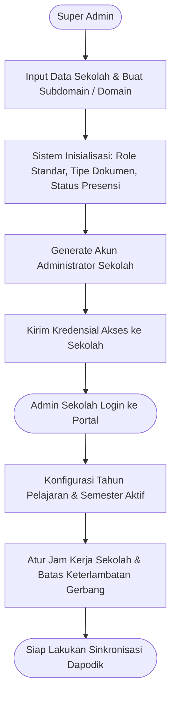
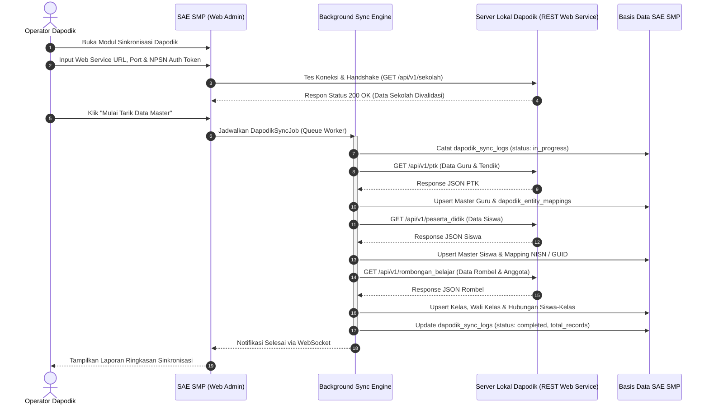
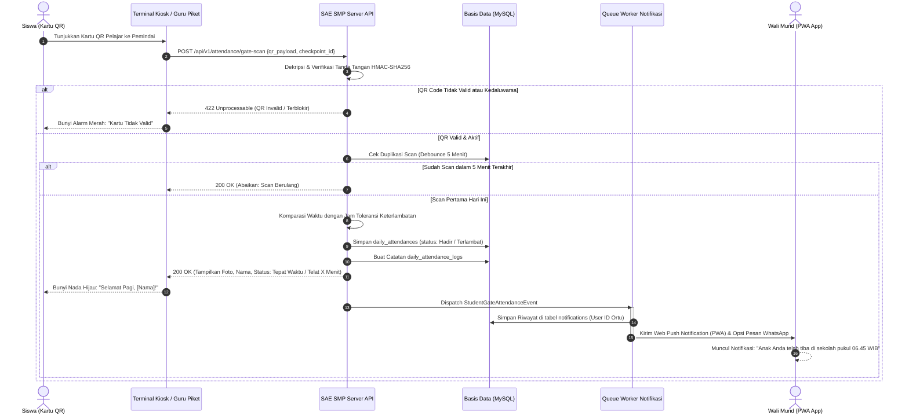
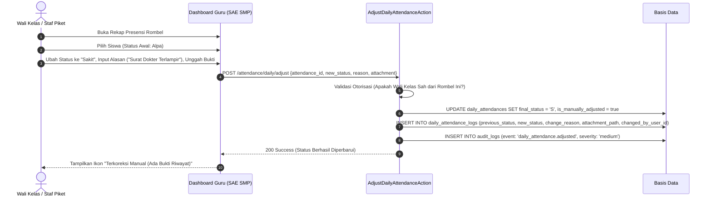
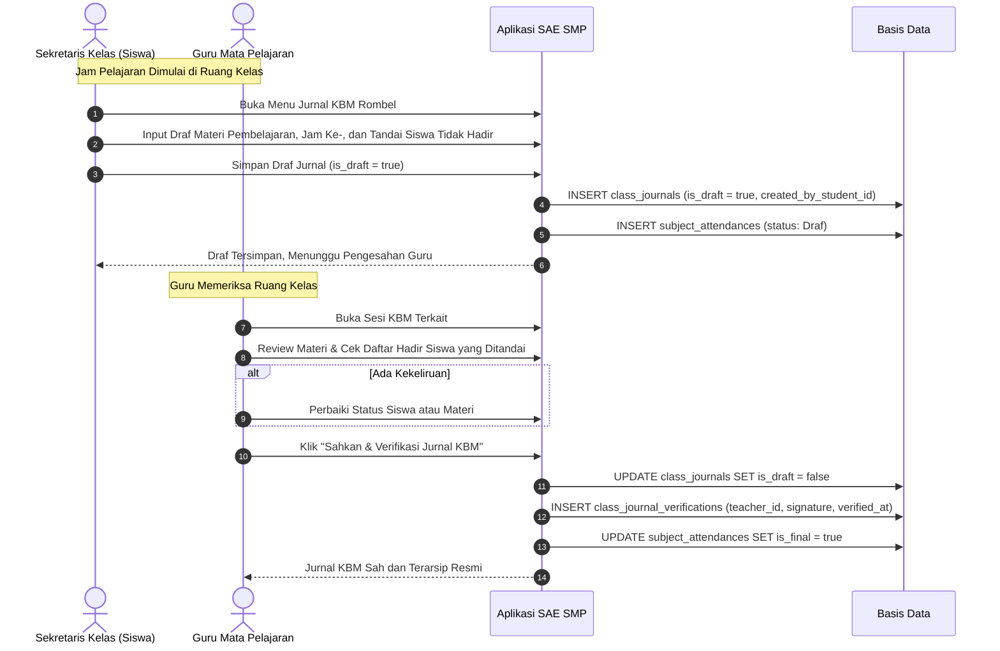
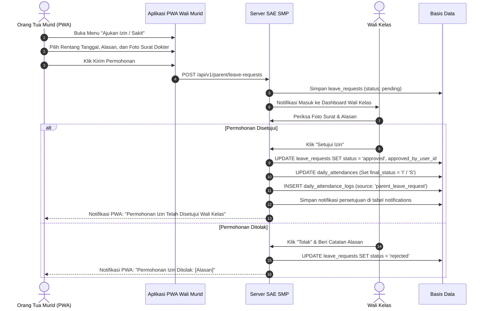
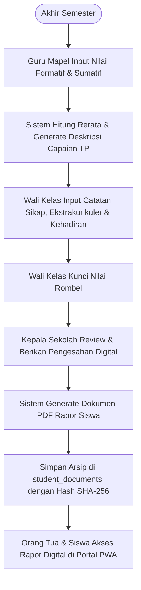

# Alur Pengguna & Interaksi Sistem (User Flows & System Interaction)
## Smart Application Education Platform (SAE SMP)

- **Versi Dokumen**: 2.0.0
- **Tanggal Pembaruan**: 2026-10-20
- **Status**: Disetujui (Approved)
- **Dokumen Terkait**:
  - [PRD.md](../PRD.md)
  - [DATABASE.md](DATABASE.md)
  - [ARCHITECTURE.md](ARCHITECTURE.md)
  - [USER_ROLES.md](USER_ROLES.md)
  - [SECURITY.md](SECURITY.md)

---

## 1. Alur Penyiapan Sekolah Baru (School Onboarding & Setup)

Alur pendaftaran dan inisialisasi tenant sekolah baru oleh Super Admin dan Admin Sekolah:

---

## 2. Alur Sinkronisasi Satu Arah Dapodik (One-Way Dapodik Sync)

Proses penarikan data resmi dari server lokal Dapodik ke SAE SMP:

---

## 3. Alur Presensi Gerbang (QR Code Scan) & Notifikasi PWA Orang Tua

Alur saat siswa memindai kartu pelajar di gerbang sekolah pada pagi dan sore hari:

---

## 4. Alur Koreksi Presensi Harian Manual & Audit Trail

Alur ketika orang tua membawa surat dokter atau wali kelas mengoreksi ketidakhadiran siswa:

---

## 5. Alur Presensi Mata Pelajaran & Pendelegasian Pengurus Kelas

Alur kolaborasi antara Sekretaris Kelas (Siswa) dan Guru Mata Pelajaran dalam pencatatan KBM:

---

## 6. Alur Pengajuan Izin/Sakit Orang Tua via PWA

Alur saat orang tua mengirim surat izin dari rumah menggunakan aplikasi PWA:

---

## 7. Alur Pelaporan Rapor & Pengarsipan Digital Siswa

